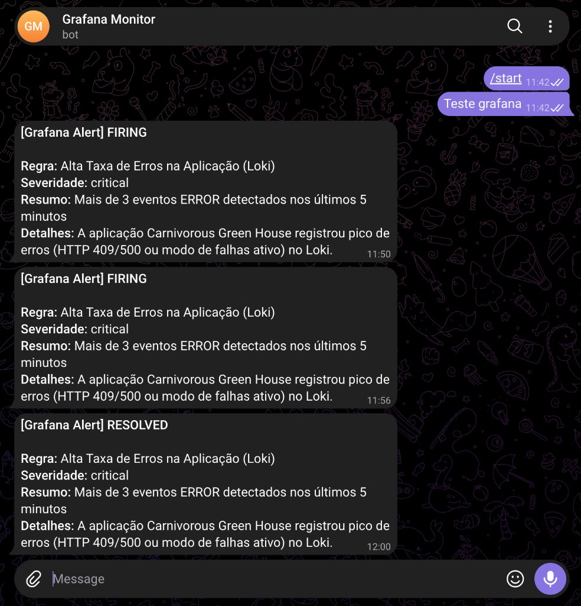

# Registro — Dashboards no Grafana e Sistema de Alertas via Telegram

Data: 20/11/2026  
Responsável: Otavio Leão  
Projeto: Carnivorous Green House (`grafana_lab`)

---

## 1. Inicialização dos Containers (`docker compose up -d --build`)

O ambiente foi iniciado localmente via **OrbStack / Docker Compose** com os 4 serviços em execução na rede bridge `loki`:

| Container | Imagem | Porta | Status | Observação |
|---|---|---|---|---|
| `carnivorous-garden` | `grafana_lab-carnivorous-garden` | `5005:5005` | Up | Aplicação Flask + SQLite + Socket.IO |
| `grafana_lab-alloy-1` | `grafana/alloy:latest` | `12345:12345` | Up | Coleta `logs/app.log` e extrai o label `level` |
| `grafana_lab-loki-1` | `grafana/loki:latest` | `3100:3100` | Up | API HTTP de logs (`/ready` → `ready`; raiz `/` retorna `404` por padrão) |
| `grafana_lab-grafana-1` | `grafana/grafana:latest` | `3000:3000` | Up | Datasource Loki, 4 dashboards e alertas provisionados |

---

## 2. Análise dos Dados e Logs Reais (`logs/app.log` → Loki)

Durante a validação, foram executados fluxos reais na aplicação (`http://localhost:5005`): cadastro de usuário (`aluno`), tentativa de cadastro duplicado (HTTP 409), login válido, 6 tentativas de login com credenciais inválidas (HTTP 401), ativação do **Modo de Falhas** (`POST /toggle_error_mode`) e bateria de logins/logouts provocando erros HTTP 500.

### Estatísticas extraídas dos registros (`logs/app.log`)
- **Total de linhas registradas:** 543 linhas (526 `INFO`, 7 `WARNING`, 7 `ERROR`).
- **Ações de negócio observadas:** `create` (1), `signup` duplicado (1), `login` (34), `logout` (16).
- **Códigos HTTP observados:** `200`, `302`, `304`, `401` (6 tentativas inválidas), `409` (1 cadastro duplicado), `500` (6 falhas aleatórias no modo de erro).
- **Achado técnico relevante na análise de logs:** o arquivo `app.py` declara o decorador `@app.after_request` três vezes (`log_response`), o que triplica cada registro de resposta HTTP no arquivo `logs/app.log` — ponto identificado ao cruzar o total de linhas `INFO` com a quantidade de requisições enviadas.

### Amostras reais capturadas
```text
time="2026-11-20 14:50:17,888" logger="__main__" level="ERROR" message="user="aluno" action="signup" status="failed" error="username exists""
time="2026-11-20 14:50:18,028" logger="__main__" level="WARNING" message="user="aluno" action="login" status="failed" error="invalid credentials""
time="2026-11-20 14:50:37,725" logger="__main__" level="ERROR" message="user="aluno" action="login" status="error" error="random failure due to error mode""
```

---

## 3. Os 4 Dashboards Criados no Grafana

Os 4 dashboards foram versionados como código em `grafana/dashboards/` e carregados automaticamente na pasta **Carnivorous Green House** via `grafana/provisioning/dashboards/dashboards.yaml`:

1. **1. Visão Geral — Tráfego & Saúde HTTP** (`grafana/dashboards/01-visao-geral-trafego.json`)
   - **URL:** `http://localhost:3000/d/cgh-visao-geral-http`
   - **Painéis:** 4 cards Stat (Total de logs, `INFO`, `WARNING`, `ERROR` em 15m), série temporal empilhada por severidade (`sum by (level) (count_over_time({level=~".+"}[1m]))`), gráfico donut de distribuição percentual e stream de logs recentes (`{filename="/tmp/app-logs/app.log"}`).

2. **2. Monitoramento de Erros & Modo de Falhas** (`grafana/dashboards/02-erros-modo-falhas.json`)
   - **URL:** `http://localhost:3000/d/cgh-erros-modo-falhas`
   - **Painéis:** Card Stat da métrica usada no alerta Telegram (`sum(count_over_time({level="ERROR"}[5m]))`), contadores separados para falhas 500 de login (`random failure due to error mode`) e logout (`Failed to loggout`), série temporal de picos de erro com threshold visual (`> 3`) e stream filtrado `{level="ERROR"}`.

3. **3. Auditoria de Autenticação & Segurança** (`grafana/dashboards/03-auditoria-autenticacao.json`)
   - **URL:** `http://localhost:3000/d/cgh-auditoria-autenticacao`
   - **Painéis:** Contadores de logins com sucesso, tentativas com `invalid credentials` (HTTP 401), novos usuários criados e cadastros duplicados (HTTP 409), gráfico temporal comparando sucesso vs falhas de autenticação e stream filtrado `{level="WARNING"} |= "invalid credentials"`.

4. **4. Estufa Carnivorous Green House & Socket.IO** (`grafana/dashboards/04-estufa-socketio.json`)
   - **URL:** `http://localhost:3000/d/cgh-estufa-socketio`
   - **Painéis:** Plantas adicionadas (`added successfully`), conexões Socket.IO (`connected and joined`), acionamentos do modo de falhas (`Error mode toggled`), falhas no envio da simulação (`Failed to send data`), série temporal de atividade da estufa e stream filtrado por regex.

---

## 4. Sistema de Alertas com Telegram

Seguindo o material de apoio (*Grafana Monitor via Telegram*):

- **Criação do Bot e Segurança:** Bot criado via `@BotFather` e Chat ID (`1458166785`) recuperado via endpoint `getUpdates` após envio de `/start` e mensagem de teste. O token do bot é armazenado apenas em `.env` local (listado no `.gitignore`, nunca commitado ou exposto em prints).
- **Contact Point (`grafana/provisioning/alerting/contactpoints.yaml`):** Nome `Telegram Monitor`, integração `telegram`, credenciais injetadas via variáveis de ambiente (`$__env{TELEGRAM_BOT_TOKEN}` e `$__env{TELEGRAM_CHAT_ID}`), formato `HTML` e envio de mensagens de disparo e resolução habilitado.
- **Notification Policy (`grafana/provisioning/alerting/policies.yaml`):** Encaminha alertas com `team = carnivorous-greenhouse` para `Telegram Monitor`.
- **Alert Rule (`grafana/provisioning/alerting/rules.yaml`):**
  - **Nome:** `Alta Taxa de Erros na Aplicação (Loki)`
  - **Consulta LogQL (Loki):** `sum(count_over_time({level="ERROR"}[5m]))`
  - **Condição:** `Reduce (last)` → `Threshold > 3` (avaliação a cada `30s`)
  - **Resultado da validação:** Ao ativar o Modo de Falhas e gerar 7 registros `ERROR`, a regra entrou em estado **Firing (`active`)** no Alertmanager do Grafana e as notificações **`[Grafana Alert] FIRING`** (11:50 e 11:56) e **`[Grafana Alert] RESOLVED`** (12:00, quando a janela de 5 min normalizou) foram recebidas com sucesso no Telegram.



---

## 5. Checklist de Conclusão (Material de Apoio)

- [x] Containers iniciados com `docker-compose`
- [x] Análise de dados e logs reais concluída
- [x] 4 dashboards criados e provisionados no Grafana
- [x] Bot criado no `@BotFather` e token protegido via `.env` (`.gitignore`)
- [x] `/start` e mensagem enviados + `chat.id` obtido
- [x] Contact Point `Telegram Monitor` criado
- [x] Contact Point associado à regra/policy de alerta
- [x] Alerta real disparado (`Firing`) e recebido no Telegram
